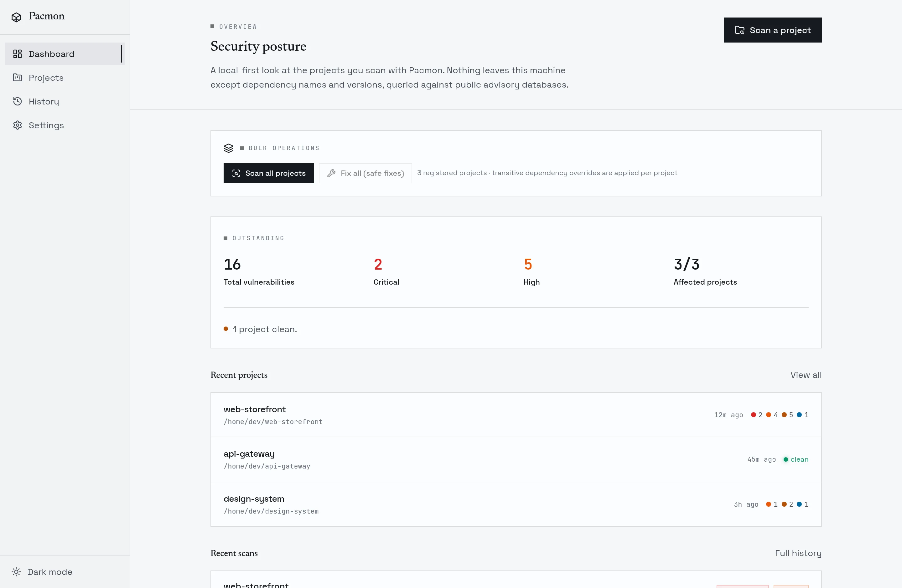
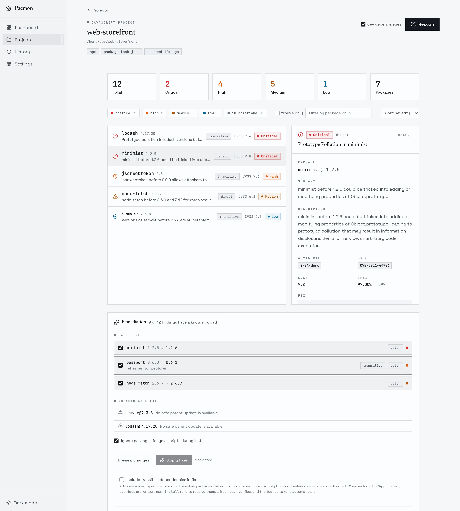
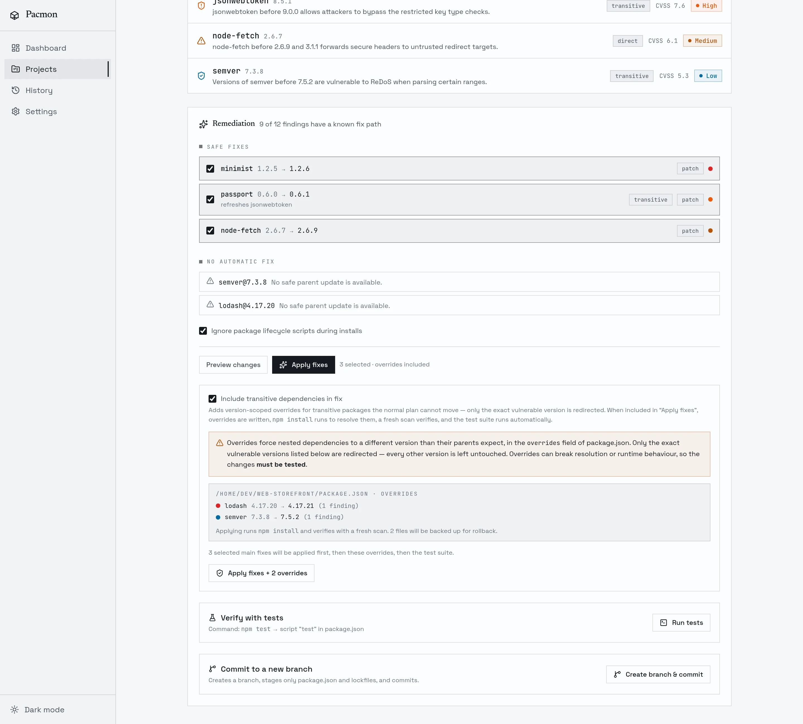
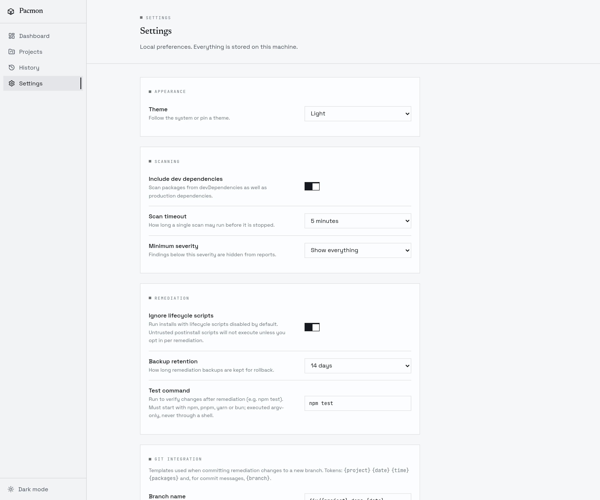
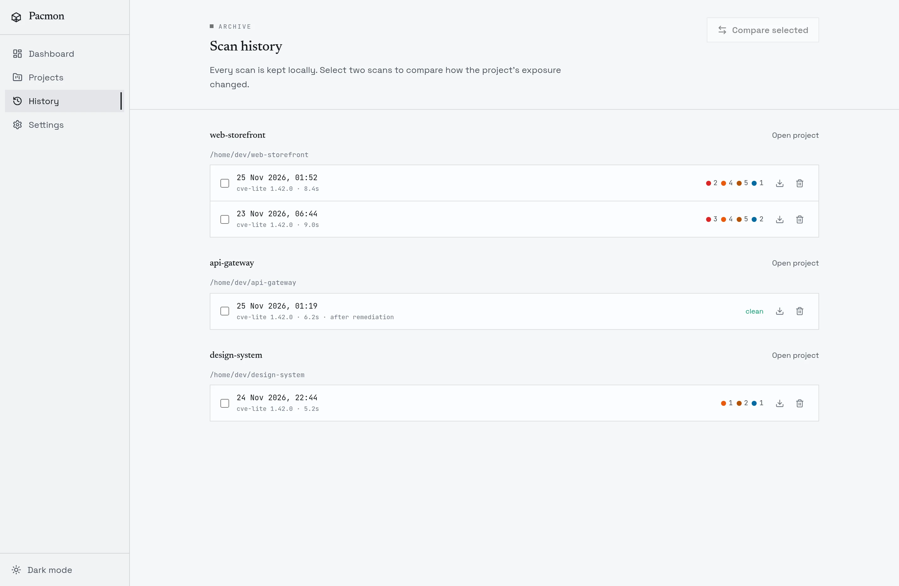

# Pacmon

Local-first package vulnerability monitoring and remediation. Pacmon scans your
JavaScript projects for known vulnerabilities, shows you exactly what's wrong and
why, fixes it in one click, and proves the fix with your own test suite entirely
on your machine. No account, no cloud, no telemetry; dependency names and versions
are the only data that leaves it, queried against the public OSV advisory database.



## Features

- **Lockfile scanning** — npm, Yarn, pnpm, and Bun projects via `package-lock.json`, `pnpm-lock.yaml`, `yarn.lock`, or `bun.lock`, with a `package.json` fallback for exact pins.
- **Clear findings** — severity, CVSS, CVE/GHSA identifiers, direct vs transitive classification, dependency paths, EPSS scores, and per-finding fix guidance.
- **One-click remediation** — safe fixes (validated direct upgrades and in-range transitive refreshes) apply automatically; breaking parent upgrades require explicit review.
- **Transitive dependency overrides** — when the dependency tree won't cooperate, Pacmon adds version-scoped overrides (npm `overrides`, yarn `resolutions`, pnpm `pnpm.overrides`) that redirect *only* the exact vulnerable version to a fixed one, leaving every other version untouched.
- **Proof, not promises** — after a fix, Pacmon runs the package manager install, executes your configured test command, and checks the installed tree with the package manager's `npm ls`-equivalent to confirm the vulnerable version is gone and the target version is installed.
- **Bulk operations** — scan every registered project in one click, then apply all safe fixes across them with live progress and per-project results.
- **Safe by default** — change previews, hashed backups with rollback, lifecycle scripts ignored unless you opt in, and every fix verified by a fresh scan before anything is called resolved.
- **Commit when you're ready** — create a branch and commit only the touched files, with configurable naming templates; commits are gated on a passing test suite when overrides were applied.
- **Local scan history** — every scan is retained; compare any two scans to see what was resolved, what remains, and what changed.
- **Extensible by design** — a common ecosystem provider contract (`detect` / `scan` / `getRemediations` / `remediate` / `verify`) so Python, IaC, and container ecosystems can be added without touching the core.

## Screenshots

### Security posture

The overview aggregates every project's latest scan: outstanding findings by
severity, affected projects, and one-click bulk scan and fix operations.


### Findings

Each finding shows severity, CVSS, CVE/GHSA identifiers, direct vs transitive
classification, dependency paths, EPSS, and fix guidance — with the advisory
detail open beside the list.



### Remediation

Safe fixes apply in one click. When transitive packages can't be moved safely,
opting into overrides shows the exact version-scoped entries that will be
written, installed, tested, and verified.



### Settings

Local preferences: scan options, the test command run after fixes, and the
branch/commit naming templates with live previews.



### Scan history

Every scan is kept locally. Select any two to compare what was resolved, what
remains, and what changed.



_Screenshots use demo data._

## Stack

- **App shell**: Electron 45, React 19, TypeScript
- **UI**: Tailwind CSS v4, framer-motion, zustand
- **Scanning**: [cve-lite-cli](https://github.com/OWASP/cve-lite-cli) (OWASP) over the OSV advisory database
- **Validation**: Zod v4
- **Tests**: Vitest — unit plus integration against a local HTTPS mock of the OSV and npm-registry APIs

## Architecture

Pacmon is split across four layers. `src/shared` holds the domain models and the
zod-validated IPC contract used by every process. `src/core` is pure,
platform-free logic: the ecosystem provider contract, the cve-lite adapter,
normalization, remediation planning, override merging, installed-version checks,
verification, backups, and git naming. `src/main` wires Electron — the window,
the engine runner (spawns cve-lite on the app's own Node), the package-manager
and test executors, the git service, and the history store — behind a narrow
typed bridge in `src/preload`. The renderer is a React app that only ever talks
to that bridge.

The security model treats projects as hostile input: the renderer is fully
sandboxed with a strict CSP, every IPC payload is validated, filesystem
operations are contained to registered project paths (symlink-aware), and
package-manager commands are built argv-only against a fixed allowlist — a
dependency name containing `&&` can never become a second command. Remediation
backs up touched files with hashed manifests before changing anything, and
rollback refuses to clobber files edited after the fix.

## Getting started

### 1. Prerequisites

Node.js 22.13+ (Electron 45 bundles Node 24, so no separate Node install is
needed for the packaged app).

### 2. Install

```bash
npm install
```

### 3. Run in development

```bash
npm run dev    # launch with hot reload
```

### 4. Verify and build

```bash
npm test               # unit + integration tests (hermetic, no network needed)
npm run typecheck

npm run build:linux    # AppImage, deb, rpm
npm run build:mac      # dmg, zip
npm run build:win      # NSIS installer
```

Cross-platform builds run in CI; macOS builds must run on macOS. Download
packaged builds from [GitHub Releases](https://github.com/aartan/pacmon/releases).

## Scripts

| Command              | Purpose                                             |
| -------------------- | --------------------------------------------------- |
| `npm run dev`        | Dev server with hot reload (Electron + Vite)        |
| `npm run build`      | Production build                                    |
| `npm run build:linux`| Package AppImage, deb, rpm                          |
| `npm run build:mac`  | Package dmg, zip                                    |
| `npm run build:win`  | Package NSIS installer                              |
| `npm run icons`      | Render `build/icon.svg` to `build/icon.png`         |
| `npm run screenshots`| Capture README screenshots with demo data           |
| `npm test`           | Unit + integration tests (Vitest)                   |
| `npm run test:watch` | Vitest in watch mode                                |
| `npm run typecheck`  | TypeScript check for main, preload, and renderer    |

## License

[MIT](LICENSE)
